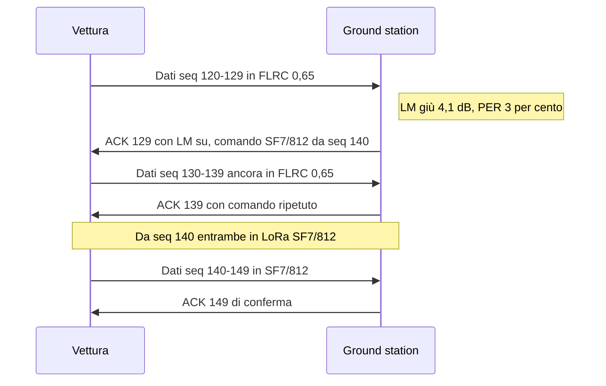

Scheda di telemetria Julia · SX1280 / E28-2G4M27SX

# Link radio di Julia

Come si misura il link con FLRC e GFSK, che non forniscono l'SNR, e come costruire su quella misura la scala ADR, l'isteresi e la sincronizzazione tra vettura e ground station. Formule, numeri calcolati e cosa resta da misurare.

Fonti: **SX1280 datasheet rev 3.0** (DS.SX1280-1-2.W.APP) **E28-2G4M27SX user manual** (Ebyte) **ETSI EN 300 328 V2.2.2** (2019-07) Documento della scheda: **telemetry_board_stasi.md**

Indice

1. [Link budget e distanze](#budget)
2. [Rumore, sensibilità e Shannon](#rumore)
3. [Cosa misura l'SX1280](#misure)
4. [Margine di link senza SNR](#margine)
5. [PER e lunghezza dei pacchetti](#per)
6. [Tempo in aria e throughput](#toa)
7. [La scala ADR](#scala)
8. [Decisione e isteresi](#isteresi)
9. [Sincronizzazione e fallback](#sync)
10. [Vincoli da datasheet e norme](#vincoli)
11. [Formulario](#formulario)
12. [Cosa misurare](#misurare)

## 01Link budget e distanze

Prima di parlare di ADR conviene capire dove sta davvero il limite del link su un circuito di Formula Student.
La potenza che arriva al ricevitore è:

Equazione del link$$P_{rx} = P_{tx} + G_{tx} - L_{tx} - PL(d) + G_{rx} - L_{rx}$$

dove \\(P\_{tx}\\) è la potenza in uscita dal modulo, \\(G\\) i guadagni d'antenna in dBi, \\(L\\) le perdite di cavi e connettori e \\(PL(d)\\) l'attenuazione del percorso alla distanza \\(d\\). Il limite di legge non riguarda \\(P\_{tx}\\) ma l'EIRP, cioè la potenza irradiata compresa l'antenna:

Limite EIRP a 2,4 GHz 

$$
\mathrm{EIRP} = P_{tx} + G_{tx} - L_{tx} \le 10 \mathrm{dBm} \quad\Rightarrow\quad P_{tx,\max} = 20 - G_{tx} + L_{tx}
$$

Con un'antenna da 5 dBi e 1 dB di cavo, il modulo deve trasmettere a 16 dBm, non a 27.

20 dBm solo con salto di frequenza

Su un canale fisso la norma limita anche la densità di potenza a 10 dBm/MHz, quindi con le bande dei modi usati l'EIRP massimo scende a circa 10–14 dBm (sezione 10). La tabella sotto usa 20 dBm come caso migliore: con 10 dBm EIRP tutti i margini calano di 10 dB e restano comunque ampi (a 500 m circa 16 dB su FLRC 1,3 CR1 e 32 dB su LoRa SF7/812).

### Attenuazione in spazio libero

Free space path loss (d in metri, f in Hz) 

$$PL_{FS}(d) = 20\log_{10} d + 20\log_{10} f - 147.55 \overset{f = 2.44 \mathrm{GHz}}= 40.2 + 20 \log_{10} d [\mathrm{dB}]$$

Ipotesi: EIRP 20 dBm, antenna di terra 5 dBi, 1 dB di cavo (Prx = 24 − PL). Sensibilità dal datasheet. Senza ostacoli né fading.

| Distanza | PL spazio libero | Prx | Margine su FLRC 1,3 CR1 (−96) | Margine su LoRa SF7/812 (−112) |
| --- | --- | --- | --- | --- |
| 50 m | 74,2 dB | −50,2 dBm | 45,8 dB | 61,8 dB |
| 100 m | 80,2 dB | −56,2 dBm | 39,8 dB | 55,8 dB |
| 200 m | 86,2 dB | −62,2 dBm | 33,8 dB | 49,8 dB |
| 500 m | 94,2 dB | −70,2 dBm | 25,8 dB | 41,8 dB |
| 1000 m | 100,2 dB | −76,2 dBm | 19,8 dB | 35,8 dB |

In spazio libero, alle distanze di un circuito, anche il modo più veloce di FLRC ha decine di dB di margine. Il link in pratica viene limitato da altre cose:

- **Shadowing**: carrozzeria, pilota, persone, altre vetture, muretti. Varia lentamente con la posizione.
- **Fading veloce** da cammini multipli: buchi profondi che durano pochi centimetri di percorso.
- **Aumento del rumore** al ricevitore: Wi-Fi e altre squadre a 2,4 GHz a terra, inverter e Wi-Fi della scheda in vettura.

### Margini per shadowing e fading

Lo shadowing si modella di solito come una variabile log-normale (gaussiana in dB) con deviazione standard \\(\\sigma\\). Per coprire una frazione \\(p\\) delle posizioni serve un margine:

Margine di shadowing \\\[ M\_{sh} = z_p\\,\\sigma \\qquad z\_{90\\%} = 1{,}28,\\quad z\_{99\\%} = 2{,}33 \\\]

Con \\(\\sigma = 6\\) dB (valore tipico, da misurare) servono circa 7,7 dB per il 90% delle posizioni e 14 dB per il 99%. È lo stesso modello di Gudmundson usato nel simulatore della tesi, con distanza di decorrelazione \\(d\_{corr}\\).

Il fading veloce, in assenza di visibilità diretta, segue la distribuzione di Rayleigh. La probabilità che la potenza scenda più di \\(F\\) dB sotto la media è:

Probabilità di un buco di fading (Rayleigh) \\\[ P\_{fade}(F) = 1 - e^{-10^{-F/10}} \\approx 10^{-F/10} \\\]

Il 1% del tempo sotto la media di 20 dB, il 10% sotto di 10 dB. Questi buchi durano frazioni di lunghezza d'onda (12 cm a 2,4 GHz), cioè millisecondi a 65 km/h: l'ADR è troppo lento per inseguirli. Li assorbono la correzione d'errore, la ripetizione e la tolleranza a qualche pacchetto perso. L'ADR deve seguire solo le variazioni lente: shadowing e rumore.

## 02Rumore, sensibilità e Shannon

Da dove vengono i numeri delle tabelle di sensibilità e cosa significano.

Il rumore termico in una banda \\(B\\) vale \\(kTB\\); a 290 K è −174 dBm/Hz. Il ricevitore aggiunge la sua cifra di rumore \\(NF\\):

Rumore di fondo del ricevitore \\\[ N\_{th} = -174 + 10\\log\_{10} B + NF\\ \\ \[\\mathrm{dBm}\] \\\]

La sensibilità è la potenza minima che dà ancora il PER di riferimento, cioè il rumore più l'SNR richiesto dal demodulatore:

Sensibilità \\\[ S = N\_{th} + \\mathrm{SNR}\_{req} \\quad\\Rightarrow\\quad S - \\left(-174 + 10\\log\_{10} B\\right) = \\mathrm{SNR}\_{req} + NF \\\]

Il datasheet non dà la \\(NF\\), quindi dai valori di sensibilità si ricava solo la somma \\(\\mathrm{SNR}\_{req} + NF\\). Per confrontare i modi basta questo.

B è la banda del ricevitore del modo (per LoRa la banda nominale 203,125 / 406,25 / 812,5 / 1625 kHz). Valori in dBm salvo dove indicato.

| Gradino (documento) | B | kTB | S | S − kTB = SNRreq + NF |
| --- | --- | --- | --- | --- |
| LoRa SF12 / 406 kHz | 406 kHz | −117,9 | −128 | −10,1 dB |
| LoRa SF11 / 812 kHz | 812 kHz | −114,9 | −123 | −8,1 dB |
| LoRa SF9 / 1625 kHz | 1625 kHz | −111,9 | −111 | +0,9 dB |
| LoRa SF7 / 812 kHz | 812 kHz | −114,9 | −112 | +2,9 dB |
| LoRa SF7 / 1625 kHz | 1625 kHz | −111,9 | −106 | +5,9 dB |
| LoRa SF5 / 1625 kHz | 1625 kHz | −111,9 | −99 | +12,9 dB |
| FLRC 0,52 CR 3/4 | 0,6 MHz | −116,2 | −104 | +12,2 dB |
| FLRC 0,65 CR 3/4 | 0,6 MHz | −116,2 | −103 | +13,2 dB |
| FLRC 1,04 CR 3/4 | 1,2 MHz | −113,2 | −100 | +13,2 dB |
| FLRC 1,3 CR 1 | 1,2 MHz | −113,2 | −96 | +17,2 dB |
| GFSK 1,6 Mb/s | 2,4 MHz | −110,2 | −84 | +26,2 dB |
| GFSK 2,0 Mb/s | 2,4 MHz | −110,2 | −83 | +27,2 dB |

Da verificare nel documento

Il documento dice che FLRC tollera un SNR fino a −5 dB. Dalla tabella, FLRC ha \\(\\mathrm{SNR}\_{req} + NF \\approx 12\\text{–}13\\) dB: anche con una cifra di rumore di 10 dB l'SNR richiesto sarebbe positivo. Nel datasheet non ho trovato il valore di −5 dB: conviene citarne la fonte o toglierlo.

### Limite di Shannon ed energia per bit

Il grafico "modem selection" del datasheet confronta i modem con il limite di Shannon, la capacità massima di un canale con rumore gaussiano:

Capacità di Shannon e Eb/N0 \\\[ C = B\\log_2\\!\\left(1 + \\mathrm{SNR}\\right) \\qquad \\frac{E_b}{N_0}\\bigg|\_{dB} = \\mathrm{SNR}\_{dB} + 10\\log\_{10}\\frac{B}{R_b} \\\]

Il secondo termine è il guadagno di elaborazione: in LoRa \\(R_b \\ll B\\), quindi si demodula con SNR negativi senza violare Shannon. Il datasheet dice che LoRa e FLRC stanno entrambi a circa 10–11 dB dal limite §6.5: FLRC non è meno efficiente di LoRa, lavora solo a data rate più alti.

### Condizioni dei valori di sensibilità

- PER 1% con pacchetti da **10 byte** di payload §3.5. Per pacchetti più lunghi serve più segnale (sezione 05).
- Modalità a **basso consumo**: i valori FSK della tabella del documento coincidono con quelli "low power mode" Tab. 3-7.
- FLRC con BT = 0,5; FSK con indice di modulazione \\(\\beta = 0{,}5\\).
- La modalità ad **alta sensibilità** (registro `0x891`, bit 7:6 = `0x3`) migliora la cifra di rumore fino a 3 dB per circa 0,5 mA in più §4.2.1. In LoRa SF7/1625 si passa da −106 a −108 dBm; in FSK a 1 Mb/s da −88 a −90 dBm. Sono dB gratuiti per tutta la scala.

## 03Cosa misura l'SX1280

Le misure disponibili cambiano con il tipo di pacchetto, ed è da qui che nasce il problema per FLRC e GFSK.

Dopo ogni ricezione si legge `GetPacketStatus()` (opcode `0x1D`). Il contenuto dipende dal tipo di pacchetto Tab. 11-63:

Nota del datasheet: "snr is only available in LoRa and Ranging Engine packet types".

| Byte | BLE, GFSK, FLRC | LoRa e Ranging |
| --- | --- | --- |
| \[7:0\] | riservato | `rssiSync` |
| \[15:8\] | `rssiSync` | `snr` |
| \[23:16\] | `errors` | non presente |
| \[31:24\] | `status` | non presente |
| \[39:32\] | `sync` | non presente |

### Conversioni

Potenza del pacchetto, potenza istantanea, SNR LoRa \\\[ P\_{pkt} = -\\frac{\\mathit{rssiSync}}{2}\\ \\mathrm{dBm} \\qquad P\_{inst} = -\\frac{\\mathit{rssiInst}}{2}\\ \\mathrm{dBm} \\qquad \\mathrm{SNR}\_{LoRa} = \\frac{\\mathit{snr}\_{(int8)}}{4}\\ \\mathrm{dB} \\\]

- `rssiSync` è la potenza latchata quando viene riconosciuta la sync word, quindi all'inizio del pacchetto Tab. 11-64.
- `rssiInst` si legge con `GetRssiInst()` (opcode `0x1F`) in ricezione, in qualsiasi momento e con qualsiasi tipo di pacchetto §11.7.3. Senza pacchetto in arrivo misura rumore e interferenze: è lo strumento per stimare il rumore anche in FLRC e GFSK.
- `snr` è in complemento a due e moltiplicato per 4.
- In LoRa con SNR negativo l'RSSI del pacchetto va corretto Tab. 11-64: \\\[ \\mathrm{SNR} \\le 0 \\;\\Rightarrow\\; P\_{pkt,reale} = P\_{pkt,misurata} - \\mathrm{SNR} \\\]
- Risoluzione 0,5 dB. Il datasheet non dichiara la precisione assoluta dell'RSSI: va calibrata.

### Il byte `errors` (FLRC e GFSK)

Tab. 11-66. Un pacchetto perso del tutto (sync non agganciata) non produce nessuno stato: si vede solo dal numero di sequenza mancante.

| Bit | Nome | Uso nell'ADR |
| --- | --- | --- |
| 6 | SyncError | sync word non riconosciuta |
| 5 | LengthError | lunghezza oltre il massimo impostato (pacchetti a lunghezza variabile) |
| 4 | CrcError | **pacchetto ricevuto ma corrotto**: conta nel PER |
| 3 | AbortError | ricezione o trasmissione interrotta |
| 2 | headerReceived | header ricevuto |
| 1 | packetReceived | ricezione completata (non garantisce la validità) |

### L'LNA della E28

La E28 ha un amplificatore a basso rumore davanti all'SX1280, con guadagno non dichiarato. L'RSSI viene misurato dopo l'LNA, quindi è più alto della potenza vera all'antenna:

Potenza all'antenna \\\[ P\_{ant} = P\_{chip} - \\Delta\_{mod} \\qquad \\Delta\_{mod} \\approx G\_{LNA} - L\_{switch} \\\]

Per l'ADR non serve conoscerlo, purché sensibilità e rumore di riferimento siano misurati nello stesso punto (sezione 04). Serve invece per confrontare la potenza misurata con quella prevista dal simulatore: si ricava \\(\\Delta\_{mod} = P\_{chip} - P\_{gen}\\) iniettando un segnale noto \\(P\_{gen}\\) da un generatore, o da una seconda scheda con attenuatori tarati.

## 04Margine di link senza SNR

Una sola misura che vale per tutti i gradini, da FLRC a LoRa SF12.

Il principio: se il rumore al ricevitore aumenta di \\(\\Delta N\\) dB, la sensibilità peggiora degli stessi \\(\\Delta N\\) dB. Quindi il margine si ottiene dall'RSSI del pacchetto, dalla sensibilità del datasheet e da una misura dell'aumento del rumore.

### 1. Calibrazione al banco

Con la vettura spenta, in un ambiente tranquillo e senza trasmissioni, per ogni banda del ricevitore usata (FLRC 0,3 / 0,6 / 1,2 MHz, GFSK 2,4 MHz, LoRa 203–1625 kHz) si misura il rumore di riferimento come media di molte letture di `GetRssiInst`:

Rumore di riferimento \\\[ N\_{ref}(B) = \\frac{1}{K}\\sum\_{k=1}^{K} P\_{inst,k} \\qquad (K \\approx 1000) \\\]

La calibrazione va fatta con la stessa modalità di ricezione che si userà in pista (basso consumo o alta sensibilità) e sulla stessa scheda, perché include l'LNA della E28.

### 2. Rumore in esercizio

In pista il ricevitore misura \\(P\_{inst}\\) negli intervalli in cui sa che il canale è libero: tra la fine di un pacchetto e l'inizio del successivo, o nella finestra prima dell'ACK. Il rumore dell'inverter arriva a impulsi, quindi non si usa la media ma un percentile alto sull'ultima finestra di misure:

Aumento del rumore \\\[ N\_{q90} = \\mathrm{percentile}\_{90\\%}\\left\\{P\_{inst}\\right\\}\_{\\text{ultima finestra}} \\qquad \\Delta N = \\max\\!\\left(0,\\ N\_{q90} - N\_{ref}(B)\\right) \\\]

### 3. Sensibilità effettiva e margine

Sensibilità effettiva \\\[ S\_{eff} = S\_{modo} + \\Delta N + C\_{len} - G\_{HS} \\\]

- \\(S\_{modo}\\): sensibilità del datasheet per il gradino attuale.
- \\(C\_{len}\\): correzione per la lunghezza reale del pacchetto (sezione 05), circa 1,2–1,5 dB.
- \\(G\_{HS}\\): guadagno della modalità ad alta sensibilità, se attiva (circa 2 dB, da misurare).

Margine di link \\\[ LM = P\_{pkt} - S\_{eff} \\\]

La formula è equivalente a un confronto tra SNR stimato e SNR richiesto:

Forma equivalente con l'SNR \\\[ \\widehat{\\mathrm{SNR}} = P\_{pkt} - N\_{q90} \\qquad \\mathrm{SNR}\_{req,eff} = S\_{modo} - N\_{ref} \\qquad LM = \\widehat{\\mathrm{SNR}} - \\mathrm{SNR}\_{req,eff} - C\_{len} + G\_{HS} \\\]

In LoRa la stessa formula vale ancora, e l'SNR fornito dal chip serve come verifica incrociata. Così l'ADR usa un'unica grandezza su tutta la scala.

Esempio numerico (valori inventati)

Gradino FLRC 0,65 CR 3/4: \\(S\_{modo} = -103\\) dBm, banda 0,6 MHz. Al banco \\(N\_{ref} = -110\\) dBm. In pista, con l'inverter a coppia massima, \\(N\_{q90} = -104\\) dBm, quindi \\(\\Delta N = 6\\) dB. Pacchetti da 127 B: \\(C\_{len} \\approx 1{,}3\\) dB. Alta sensibilità spenta.

\\\[ S\_{eff} = -103 + 6 + 1{,}3 = -95{,}7\\ \\mathrm{dBm} \\qquad P\_{pkt} = -88\\ \\mathrm{dBm} \\;\\Rightarrow\\; LM = 7{,}7\\ \\mathrm{dB} \\\]

Con un obiettivo di 6 dB il gradino va bene. Se l'RSSI scendesse a −91 dBm, LM = 4,7 dB e l'ADR dovrebbe scendere di un gradino.

### 4. Due direzioni, un solo gradino

Il link vettura → terra (telemetria) e quello terra → vettura (ACK) hanno rumori diversi: a terra pesano Wi-Fi e altre squadre, in vettura l'inverter e il Wi-Fi della scheda. Ciascun ricevitore calcola il suo margine. Siccome i due lati devono usare lo stesso gradino, conta il peggiore:

Margine del link bidirezionale \\\[ LM\_{link} = \\min\\!\\left(LM\_{\\downarrow},\\ LM\_{\\uparrow}\\right) \\\]

\\(LM\_{\\downarrow}\\) è misurato dalla ground station sui pacchetti dati; \\(LM\_{\\uparrow}\\) dalla vettura sugli ACK e rimandato nel pacchetto dati successivo.

Attenzione alle finestre di misura

- Il rumore va misurato solo quando l'altro lato non trasmette: lo schema temporale del protocollo deve prevedere finestre di ascolto note.
- Se il rumore dipende dalla posizione del pedale, conviene registrare anche \\(\\Delta N\\) insieme alla telemetria: è un dato utile per la tesi.
- Durante la propria trasmissione la scheda non può misurare: con il PA a 20+ dBm a pochi centimetri, anche un'antenna Wi-Fi accesa sulla stessa scheda falsa la misura. Wi-Fi e BLE spenti in pista.

## 05PER e lunghezza dei pacchetti

Perché un pacchetto da 127 B ha bisogno di più segnale di quello usato dal datasheet, e quanti pacchetti servono per stimare il PER.

Se gli errori sui bit sono indipendenti con probabilità BER, un pacchetto di \\(n\\) byte arriva integro solo se lo sono tutti gli \\(8n\\) bit:

PER in funzione della lunghezza \\\[ \\mathrm{PER}(n) = 1 - \\left(1 - \\mathrm{BER}\\right)^{8n} \\qquad \\mathrm{BER}\_{n,\\,1\\%} = 1 - 0{,}99^{1/(8n)} \\\]

Il datasheet dà la sensibilità per PER 1% con 10 B: la BER corrispondente è \\(1 - 0{,}99^{1/80} \\approx 1{,}26\\cdot 10^{-4}\\). Alla stessa potenza, un pacchetto più lungo si perde molto più spesso:

Clen: dB in più per riportare il PER all'1%, calcolati con le curve teoriche di BER (sotto). Ordine di grandezza; il valore vero si misura.

| Payload | PER alla sensibilità del datasheet | BER per PER 1% | Clen MSK coerente | Clen FSK non coerente |
| --- | --- | --- | --- | --- |
| 10 B | 1,0% | 1,26·10⁻⁴ | 0 | 0 |
| 20 B | 2,0% | 6,3·10⁻⁵ | 0,4 dB | 0,35 dB |
| 101 B | 9,7% | 1,2·10⁻⁵ | 1,2 dB | 1,1 dB |
| 127 B | 12,0% | 9,9·10⁻⁶ | 1,3 dB | 1,2 dB |
| 140 B | 13,1% | 9,0·10⁻⁶ | 1,4 dB | 1,2 dB |
| 202 B | 18,4% | 6,2·10⁻⁶ | 1,5 dB | 1,3 dB |

Per calcolare \\(C\_{len}\\) serve la pendenza della curva BER–SNR. Per un demodulatore MSK coerente (la base di FLRC, senza codifica) e per FSK non coerente:

Curve di BER teoriche \\\[ \\mathrm{BER}\_{MSK} = Q\\!\\left(\\sqrt{2E_b/N_0}\\right) \\qquad \\mathrm{BER}\_{FSK,nc} = \\tfrac12\\, e^{-E_b/(2N_0)} \\qquad C\_{len} = \\left.\\tfrac{E_b}{N_0}\\right|\_{\\mathrm{BER}\_n} - \\left.\\tfrac{E_b}{N_0}\\right|\_{\\mathrm{BER}\_{10}} \\\]

Con la correzione d'errore (FLRC con CR 3/4 o 1/2, LoRa) la curva è più ripida e \\(C\_{len}\\) più piccolo; in LoRa gli errori dopo l'interleaving non sono indipendenti e la formula vale solo come stima. In tutti i casi 1–1,5 dB è una prima approssimazione ragionevole da sostituire con una misura.

### Stimare il PER in esercizio

Il PER si stima su una finestra di pacchetti attesi, contando quelli mancanti (buchi nei numeri di sequenza) e quelli con `CrcError`:

Stimatore del PER \\\[ \\widehat{\\mathrm{PER}} = \\frac{n\_{persi} + n\_{CRC}}{n\_{attesi}} \\qquad \\sigma\_{\\widehat{\\mathrm{PER}}} = \\sqrt{\\frac{p\\,(1-p)}{n\_{attesi}}} \\\]

Per vedere in media \\(k\\) errori con un PER vero \\(p\\) servono \\(n \\approx k/p\\) pacchetti. Se in \\(n\\) pacchetti non c'è nessun errore, al 95% di confidenza \\(p \\lt 3/n\\) (regola del tre).

1000 pacchetti servono per vedere circa 10 errori con PER 1%.

| Gradino | Pacchetti al secondo (60% del tempo, 127 B) | Tempo per 1000 pacchetti |
| --- | --- | --- |
| FLRC 0,65 CR 3/4 | 265 | ≈ 4 s |
| LoRa SF7 / 812 | 18 | ≈ 55 s |
| LoRa SF11 / 812 | 1,4 | ≈ 12 min |

Ai gradini veloci il PER è una misura affidabile; a quelli lenti no. Conviene decidere sempre sul margine e usare il PER come allarme: un PER alto su pochi pacchetti è già un motivo per scendere.

## 06Tempo in aria e throughput

Le formule del datasheet per i tre tipi di pacchetto e cosa ne segue per i pacchetti della scheda.

### FLRC §7.3.4

Il pacchetto FLRC è fatto di un preambolo AGC (1–4 byte; almeno 2 sotto 1,3 Mb/s), 21 bit di preambolo di temporizzazione, 32 bit di sync word, un header di 16 bit se la lunghezza è variabile, il payload (**da 6 a 127 byte**), un CRC da 2–4 byte e 6 bit di coda. Payload, CRC e coda passano per il codificatore convoluzionale:

Tempo in aria FLRC \\\[ n\_{unc} = n\_{AGC} + 21 + 32 + n\_{hdr} \\qquad n\_{cod} = \\left\\lceil \\frac{8L + 8L\_{CRC} + n\_{tail}}{CR} \\right\\rceil \\qquad T\_{FLRC} = \\frac{n\_{unc} + n\_{cod}}{R_b} \\\]

con \\(n\_{hdr} = 16\\) se la lunghezza è variabile, \\(n\_{tail} = 6\\) per CR 1/2 e 3/4 (0 con CR 1), \\(R_b\\) il bit rate grezzo. Il bit rate effettivo è \\(R\_{b,eff} = R_b \\cdot CR\\).

### GFSK §7.1

Preambolo 0,5–4 byte (almeno 2 sotto 1 Mb/s), sync word 1–5 byte, header di 9 bit se la lunghezza è variabile, payload fino a 255 B, CRC 1–2 byte. Niente codifica:

Tempo in aria GFSK \\\[ T\_{GFSK} = \\frac{8\\left(L\_{pre} + L\_{sync} + L + L\_{CRC}\\right) + n\_{hdr}}{R_b} \\\]

I parametri del modulatore sono legati da §6.4:

Indice di modulazione e banda occupata \\\[ \\beta = \\frac{2\\,\\Delta f}{R_b}\\ \\ (0{,}35 \\le \\beta \\le 2) \\qquad B\_{-20\\,dB} \\approx 2\\,\\Delta f + R_b = R_b\\,(1 + \\beta) \\\]

### LoRa §7.4.4

Il tempo di simbolo è \\(T_s = 2^{SF}/BW\\). Il numero di simboli, con coding rate classico \\(CR \\in \\{1,2,3,4\\}\\) per 4/5…4/8, CRC (\\(N\_{CRC} = 16\\)) e header esplicito (\\(N\_{H} = 20\\)):

Numero di simboli LoRa \\\[ N\_{sym} = N\_{pre} + c_0 + 8 + \\left\\lceil \\frac{\\max\\!\\left(8L + N\_{CRC} - 4\\,SF + c_1 + N\_{H},\\ 0\\right)}{4\\,(SF - 2\\,DE)} \\right\\rceil (CR + 4) \\\] \\\[ SF \\lt 7:\\ c_0 = 6{,}25,\\ c_1 = 0,\\ DE = 0 \\qquad 7 \\le SF \\le 10:\\ c_0 = 4{,}25,\\ c_1 = 8,\\ DE = 0 \\qquad SF \\gt 10:\\ c_0 = 4{,}25,\\ c_1 = 8,\\ DE = 1 \\\] \\\[ T\_{LoRa} = N\_{sym}\\, T_s \\\]

Verifica

Nel PDF del datasheet le equazioni di §7.4.4.1 sono immagini: la forma qui sopra è quella che ho usato per i calcoli. Confrontala con la pagina 47 prima di metterla nel documento della scheda.

### Throughput e occupazione del canale

Frequenza massima dei pacchetti e occupazione \\\[ f\_{\\max} = \\frac{u\_{\\max}}{T\_{ToA}(L) + T\_{turn}} \\qquad u = f \\cdot T\_{ToA} \\qquad R\_{utile} = \\frac{8L}{T\_{ToA} + T\_{turn}} \\\]

dove \\(u\_{\\max}\\) è la quota di tempo concessa ai dati (per esempio 60%, lasciando il resto ad ACK, finestre di misura del rumore e margine) e \\(T\_{turn}\\) il tempo di commutazione tra trasmissione e ricezione.

LoRa: preambolo 12, CR 4/5, CRC, header esplicito (Rb,eff = 0,8 · SF · BW / 2SF). FLRC: lunghezza variabile, CRC 2 B. GFSK: preambolo 2 B, sync 4 B, CRC 2 B. Tturn trascurato.

| Gradino | S | Rb,eff | ACK 20 B | 127 B | 140 B | fmax 127 B (60%) |
| --- | --- | --- | --- | --- | --- | --- |
| LoRa SF12 / 406 | −128 | 1,0 kb/s | 446 ms | 1555 ms | 1656 ms | 0,4 /s |
| LoRa SF11 / 812 | −123 | 3,5 kb/s | 124 ms | 427 ms | 464 ms | 1,4 /s |
| LoRa SF9 / 1625 | −111 | 22,9 kb/s | 15,5 ms | 53,3 ms | 58,1 ms | 11 /s |
| LoRa SF7 / 812 | −112 | 35,5 kb/s | 9,3 ms | 33,0 ms | 36,1 ms | 18 /s |
| LoRa SF7 / 1625 | −106 | 71,1 kb/s | 4,7 ms | 16,5 ms | 18,1 ms | 36 /s |
| LoRa SF5 / 1625 | −99 | 203 kb/s | 1,4 ms | 5,6 ms | 6,1 ms | 106 /s |
| FLRC 0,52 CR 3/4 | −104 | 390 kb/s | 0,63 ms | 2,82 ms | non entra | 212 /s |
| FLRC 0,65 CR 3/4 | −103 | 488 kb/s | 0,50 ms | 2,26 ms | non entra | 265 /s |
| FLRC 1,04 CR 3/4 | −100 | 780 kb/s | 0,32 ms | 1,41 ms | non entra | 425 /s |
| FLRC 1,3 CR 1 | −96 | 1300 kb/s | 0,19 ms | 0,85 ms | non entra | 703 /s |
| GFSK 1,6 Mb/s | −84 | 1600 kb/s | 0,15 ms | 0,68 ms | 0,75 ms | 882 /s |
| GFSK 2,0 Mb/s | −83 | 2000 kb/s | 0,12 ms | 0,54 ms | 0,60 ms | 1102 /s |

Conseguenze per i pacchetti della scheda

- **FLRC accetta al massimo 127 byte di payload** §7.3.2. Il pacchetto ECU da 202 B va diviso in due frammenti; il pacchetto dinamico da 140 B va ridotto a 127 B o diviso. GFSK e LoRa arrivano a 255 B.
- Il flusso completo a 200 Hz in FLRC 0,65 CR 3/4, in due frammenti da 101 B, occupa 3,67 ms per pacchetto ECU, cioè il **73%** del tempo prima ancora di ACK e misure: è al limite.
- Il pacchetto dinamico da 140 B a 15 Hz occupa il 54% del tempo in LoRa SF7/812, l'87% in SF9/1625, e non entra in SF11/812 (464 ms a pacchetto). Sotto SF7 l'ADR deve ridurre anche frequenza e payload.

## 07La scala ADR

Un criterio oggettivo per scegliere i gradini: tenere solo i modi che non sono peggiori di un altro in tutto.

Ogni modo ha due numeri che contano: la sensibilità \\(S\\) (più bassa è meglio) e il bit rate effettivo \\(R\_{b,eff}\\) (più alto è meglio). Un modo \\(A\\) **domina** un modo \\(B\\) se è almeno altrettanto buono in entrambi e migliore in almeno uno:

Dominanza \\\[ A \\succ B \\iff S_A \\le S_B \\ \\wedge\\ R_A \\ge R_B \\ \\wedge\\ \\left(S_A \\lt S_B \\ \\vee\\ R_A \\gt R_B\\right) \\\]

Un modo dominato non serve mai, almeno in rumore gaussiano: c'è sempre un'alternativa più sensibile e più veloce. L'insieme dei modi non dominati (frontiera di Pareto) è il candidato naturale per la scala. Calcolato su tutte le combinazioni del datasheet (LoRa con CR 4/5, FLRC, GFSK):

Sensibilità in modalità a basso consumo, dBm. ΔS in dB.

| Modo sulla frontiera | S | Rb,eff | ΔS dal precedente | Nella scala del documento |
| --- | --- | --- | --- | --- |
| LoRa SF12 / 203 | −130 | 0,48 kb/s | – | no |
| LoRa SF12 / 406 | −128 | 0,95 kb/s | 2 | sì |
| LoRa SF12 / 812 | −126 | 1,9 kb/s | 2 | no |
| LoRa SF11 / 812 | −123 | 3,5 kb/s | 3 | sì |
| LoRa SF10 / 812 | −120 | 6,3 kb/s | 3 | no |
| LoRa SF9 / 812 | −117 | 11,4 kb/s | 3 | no |
| LoRa SF8 / 812 | −115 | 20,3 kb/s | 2 | no |
| LoRa SF7 / 812 | −112 | 35,5 kb/s | 3 | sì |
| LoRa SF8 / 1625 | −109 | 40,6 kb/s | 3 | no |
| LoRa SF6 / 812 | −108 | 60,9 kb/s | 1 | no |
| FLRC 0,325 CR 3/4 | −106 | 244 kb/s | 2 | no |
| FLRC 0,52 CR 3/4 | −104 | 390 kb/s | 2 | sì |
| FLRC 0,65 CR 3/4 | −103 | 488 kb/s | 1 | sì |
| FLRC 1,04 CR 1/2 | −101 | 520 kb/s | 2 | no |
| FLRC 1,3 CR 3/4 | −100 | 975 kb/s | 1 | no |
| FLRC 1,04 CR 1 | −97 | 1040 kb/s | 3 | no |
| FLRC 1,3 CR 1 | −96 | 1300 kb/s | 1 | sì |
| GFSK 1,6 Mb/s | −84 | 1600 kb/s | 12 | sì |
| GFSK 2,0 Mb/s | −83 | 2000 kb/s | 1 | sì |

| Gradini del documento fuori dalla frontiera | Dominato da |
| --- | --- |
| LoRa SF9 / 1625 (−111, 22,9 kb/s) | LoRa SF7 / 812 (−112, 35,5 kb/s) |
| LoRa SF7 / 1625 (−106, 71 kb/s) | FLRC 0,325 CR 3/4 (−106, 244 kb/s) |
| LoRa SF5 / 1625 (−99, 203 kb/s) | FLRC 0,52 CR 3/4 (−104, 390 kb/s) |
| FLRC 1,04 CR 3/4 (−100, 780 kb/s) | FLRC 1,3 CR 3/4 (−100, 975 kb/s) |

Il criterio vale in rumore gaussiano. Ci sono due ragioni legittime per tenere un modo dominato, ma vanno dimostrate con misure:

- **Resistenza alle interferenze**: LoRa a spettro espanso può resistere meglio di FLRC a interferenze a banda stretta o impulsive (il datasheet dà per LoRa SF12 una reiezione co-canale di 19,5 dB contro −10 dB di FLRC e FSK, Tab. 3-5/3-6/3-7). Se l'inverter produce questo tipo di disturbo, un LoRa a bit rate alto può valere più del FLRC con la stessa sensibilità.
- **Banda occupata**: in un paddock affollato una banda stretta incontra meno interferenze.

Sui gradini più alti serve anche guardare al bisogno reale: il flusso completo a 200 Hz richiede circa 330 kb/s di dati più l'overhead, e FLRC 0,65 CR 3/4 basta già. Ogni gradino sopra aumenta il throughput che non serve e costa da 4 a 20 dB di sensibilità.

### Ampiezza dei gradini

Il salto di sensibilità tra gradini consecutivi decide quanto deve essere ampia l'isteresi (sezione 08). Salti piccoli (1–3 dB) permettono di seguire bene il canale; salti grandi (il documento passa da SF7/812 a SF11/812, 11 dB, e da FLRC 1,3 a GFSK 1,6, 12 dB) costringono a tenere margini larghi o a cambiare gradino solo in situazioni estreme.

## 08Decisione e isteresi

Regole per cambiare gradino senza oscillare, e per adattare frequenza e payload quando il gradino scende.

Si numerano i gradini dal più robusto (\\(i = 0\\)) al più veloce (\\(i = I\\)). \\(\\Delta S\_{i \\to i+1} = S\_{i+1} - S_i \\gt 0\\) è quanta sensibilità si perde salendo. \\(LM_t\\) è il margine obiettivo (6 dB nel documento), \\(H\\) l'isteresi.

### Scendere: veloce

Condizione per scendere di un gradino \\\[ \\Big(LM_k \\lt LM\_{\\min} \\ \\text{per } k\_{down} \\text{ pacchetti consecutivi}\\Big) \\ \\vee\\ \\Big(\\widehat{\\mathrm{PER}} \\gt \\mathrm{PER}\_{\\max}\\Big) \\ \\vee\\ \\Big(\\text{ACK mancante}\\Big) \\\]

Con \\(LM\_{\\min}\\) un po' sotto l'obiettivo (per esempio \\(LM_t - 2\\) dB) e \\(k\_{down} = 2\\). Se il margine è molto sotto, si può scendere di più gradini insieme: si sceglie il gradino più veloce \\(j\\) per cui \\(LM_k + (S_i - S_j) \\ge LM_t\\).

### Salire: lento

Condizione per salire di un gradino \\\[ \\overline{LM}\_k - \\Delta S\_{i\\to i+1} \\ge LM_t + H \\ \\text{ per } N\_{up} \\text{ pacchetti consecutivi} \\quad \\wedge \\quad t - t\_{\\text{ultimo cambio}} \\ge T\_{dwell} \\\]

Per salire si usa un margine filtrato (media esponenziale), così un picco isolato non basta:

Filtro del margine \\\[ \\overline{LM}\_k = \\alpha\\, LM_k + (1 - \\alpha)\\, \\overline{LM}\_{k-1} \\qquad 0 \\lt \\alpha \\le 1 \\\]

### Come scegliere Nup e Tdwell

Lo shadowing cambia su una distanza dell'ordine di \\(d\_{corr}\\) (il simulatore usa 10 m). Perché una salita abbia senso, il margine deve restare buono per almeno quel tratto:

Tempo minimo di permanenza \\\[ T\_{dwell} \\ge \\frac{d\_{corr}}{v} \\qquad N\_{up} \\ge \\frac{T\_{dwell}}{T\_{pkt}} \\\]

A 65 km/h (18 m/s) e con \\(d\_{corr} = 10\\) m, \\(T\_{dwell} \\approx 0{,}55\\) s. Ai gradini veloci sono centinaia di pacchetti; ai gradini lenti il vincolo è il tempo, non il numero di pacchetti.

### Adattare frequenza e payload

Il gradino dice quanti pacchetti entrano al secondo; la frequenza di trasmissione si adatta di conseguenza:

Frequenza di trasmissione per gradino \\\[ f_i = \\min\\!\\left(f\_{target},\\ \\frac{u\_{\\max}}{T\_{ToA}(i, L) + T\_{turn}}\\right) \\qquad f_i \\lt f\_{\\min} \\ \\Rightarrow\\ \\text{pacchetto di emergenza} \\\]

Per esempio con \\(f\_{target} = 15\\) Hz, \\(f\_{\\min} = 5\\) Hz e pacchetti da 127 B: FLRC e LoRa SF7/812 restano a 15 Hz, LoRa SF9/812 (107 ms a pacchetto) scende a circa 5,6 Hz, da SF10/812 in giù (194 ms) resta solo il pacchetto di emergenza. Una scala con pacchetti di dimensione decrescente (127 B, poi 64 B, poi emergenza) rende la discesa più graduale.

## 09Sincronizzazione e fallback

I due SX1280 si parlano solo se tutti i parametri coincidono: il cambio deve essere deciso, comunicato e confermato.

### Parametri che devono coincidere

- Frequenza o canale.
- Tipo di pacchetto (LoRa, FLRC, GFSK) e parametri di modulazione: SF e BW; bit rate, banda, CR e BT; bit rate, banda e β.
- Preambolo, sync word, CRC (presenza e lunghezza), modo dell'header (lunghezza fissa o variabile), whitening.
- Fa eccezione il CR di LoRa con header esplicito: il ricevitore lo legge dall'header §7.4.2.

### Chi decide

Le misure del link dati le ha la ground station, quindi conviene che sia lei a decidere. Il comando viaggia nell'ACK insieme al numero di sequenza da cui il cambio scatta, ed è ripetuto in più ACK consecutivi: se la vettura ne perde uno, lo riceve dal successivo.

### Costo degli ACK

Con un ACK ogni \\(M\\) pacchetti dati, la quota di tempo spesa per il feedback è:

Overhead degli ACK \\\[ \\eta\_{ACK} = \\frac{T\_{ACK} + 2\\,T\_{turn}}{M\\,T\_{pkt} + T\_{ACK} + 2\\,T\_{turn}} \\\]

In FLRC 0,65 CR 3/4 con pacchetti da 127 B, ACK da 20 B e \\(T\_{turn} = 0{,}1\\) ms (ipotesi): \\(\\eta = 5{,}9\\%\\) con \\(M = 5\\), 3,0% con \\(M = 10\\), 1,5% con \\(M = 20\\). Ai gradini lenti un ACK da 20 B dura 124 ms (SF11/812) o 446 ms (SF12/406): lì conviene un ACK più corto e meno frequente, misurato in tempo e non in pacchetti.

### Timeout e fallback

Timeout \\\[ T\_{out}(i) = K \\cdot \\left(M_i\\,T\_{pkt}(i) + T\_{ACK}(i) + 2\\,T\_{turn}\\right) \\qquad K \\approx 3 \\\]

- **Vettura**: se non riceve un ACK valido per \\(T\_{out}\\), torna al gradino di fallback \\(F\\).
- **Ground station**: se non riceve dati validi per \\(T\_{out}\\), torna anche lei a \\(F\\) e manda ACK in \\(F\\).
- Il fallback è simmetrico e basato sul tempo: funziona anche se il link si è perso da un solo lato, e non richiede di scambiarsi messaggi quando il link non c'è.
- **Avvio**: entrambe partono in \\(F\\).
- **Ripartenza**: da \\(F\\) si risale con le regole di isteresi della sezione 08.

La scelta di \\(F\\) è un compromesso: un gradino molto robusto (SF11, SF12) si aggancia quasi sempre, ma ogni ritorno costa secondi di dati quasi nulli; un gradino intermedio (LoRa SF7/812) riparte in fretta ma potrebbe non agganciarsi con il canale peggiore. Una soluzione è un fallback a due livelli: prima SF7/812, poi, se anche lì manca il link per \\(T\_{out}\\), SF11/812.

## 10Vincoli da datasheet e norme

E28-2G4M27SX

- Alimentazione 2,5–3,6 V, tipica 3,3 V. **Massimo assoluto 3,6 V**: "Exceeding 3.6V will permanently burn the module". Livelli logici a 3,3 V: "Risk of burnout with 5V TTL".
- Corrente in trasmissione 580 mA, in ricezione 14,5 mA. Potenza massima 26–27 dBm, garantita da 3,3 V in su.
- SPI dichiarato da 0 a 10 Mbps, meno dei 18 MHz dell'SX1280 da solo.
- FIFO da 256 byte; quarzo 52 MHz ±10 ppm.
- Potenza massima in ingresso 10 dBm: con due schede a pochi centimetri, entrambe a piena potenza, si può superare. Al banco usare attenuatori.

### Lunghezze dei pacchetti

| Tipo | Payload | Fonte |
| --- | --- | --- |
| FLRC | 6–127 B | §7.3.2 |
| GFSK | 0–255 B | §7.1 |
| LoRa | fino a 255 B | §7.4 |

### Potenza e normativa EN 300 328 V2.2.2

La norma armonizzata per la banda a 2,4 GHz divide gli apparati in **FHSS** (salto di frequenza, §4.3.1) e **non-FHSS** (canale fisso, §4.3.2), e ognuno può essere **adattivo** (ascolta il canale con LBT o DAA) o **non adattivo**. I limiti valgono per entrambe le schede, ground station compresa.

Per l'FHSS non c'è il limite di PSD; in compenso servono abbastanza frequenze e limiti sul tempo per frequenza.

| Requisito | Valore | Clausola |
| --- | --- | --- |
| Potenza RF | ≤ 20 dBm EIRP, con qualsiasi antenna dichiarata | §4.3.1.2.3 / §4.3.2.2.3 |
| Densità spettrale di potenza (solo non-FHSS) | ≤ 10 dBm/MHz EIRP | §4.3.2.3 |
| Non adattivo: Tx-sequence e Tx-gap | sequenza ≤ 10 ms, pausa ≥ sequenza e ≥ 3,5 ms | §4.3.2.4 |
| Non adattivo: Medium Utilisation | MU = (Pout/100 mW) · DC ≤ 10% | §4.3.2.5 |
| Adattivo: LBT o DAA | vedi sotto | §4.3.2.6 |
| Esenzioni sotto 10 dBm EIRP | niente Tx-sequence/gap, MU né adattività | §4.3.2.4.1, §4.3.2.5.1, §4.3.2.6.1 |

L'LBT quindi **non è obbligatorio**: è uno dei modi per trasmettere sopra 10 dBm senza limiti di duty cycle. Il vincolo che pesa di più a canale fisso è la densità di potenza, che l'LBT non toglie:

EIRP massimo a canale fisso (B = banda occupata) \\\[ \\mathrm{EIRP}\_{\\max} = \\min\\!\\big(20,\\; 10 + 10\\log\_{10}(B / 1\\ \\mathrm{MHz})\\big)\\ \\mathrm{dBm} \\\]

Per bande sotto 1 MHz la PSD si misura su 1 MHz, quindi il limite resta 10 dBm. La banda vera è quella occupata misurata (OCB), da verificare al banco.

| Modo | Banda | EIRP max |
| --- | --- | --- |
| FLRC 0,325–0,65 Mb/s, LoRa ≤ 812 kHz | ≤ 1 MHz | ≈ 10 dBm |
| FLRC 1,3 Mb/s | 1,2 MHz | ≈ 10,8 dBm |
| LoRa 1625 kHz | 1,6 MHz | ≈ 12 dBm |
| GFSK 2 Mb/s | 2,4 MHz | ≈ 13,8 dBm |

### Opzioni

L'FHSS non adattivo sopra 10 dBm ha sequenze ≤ 5 ms, pause ≥ 5 ms e MU ≤ 10%: a 20 dBm trasmette il 10% del tempo, inadatto a una telemetria continua. L'opzione D è quella dei moduli ExpressLRS venduti come "LBT" per l'Europa, sulla stessa famiglia SX1280/SX1281 a 100 mW.

| Opzione | EIRP | Cosa serve | Valutazione |
| --- | --- | --- | --- |
| **A.** Canale fisso, sotto 10 dBm | ≤ 9,9 dBm | Niente LBT, niente limiti di duty cycle | **Consigliata**: la più semplice, margini ancora ampi |
| **B.** Canale fisso, non adattivo | 10–14 dBm | Sequenze ≤ 10 ms, DC ≤ 50%, MU ≤ 10% | +1–4 dB e metà del tempo perso: no |
| **C.** Canale fisso, LBT | 10–14 dBm | LBT load-based (sotto) | +1–4 dB con molta complessità: no |
| **D.** FHSS adattivo con LBT | fino a 20 dBm | ≥ 15 frequenze su ≥ 70% della banda, ≤ 400 ms per frequenza, CCA a ogni salto | +10 dB e diversità contro il Wi-Fi; sincronizzazione, ADR e fallback più complessi |

### LBT load-based §4.3.2.6.3.2.3

- **CCA a rilevamento di energia** di almeno 18 µs prima di trasmettere. Se il canale è occupato, CCA estese di durata casuale tra 18 µs e almeno 160 µs, finché il canale non si libera.
- **Channel Occupancy Time** sotto i 13 ms, poi nuova CCA.
- Un apparato che ha ricevuto correttamente un pacchetto può rispondere con l'**ACK senza CCA**, dentro il COT.
- Soglia di occupazione, riferita a un'antenna da 0 dBi:

Soglia LBT e valore da confrontare con l'RSSI del chip \\\[ TL = -70 + 10\\log\_{10}\\frac{100\\ \\mathrm{mW}}{P\_{out}}\\ \\ \[\\mathrm{dBm/MHz}\] \\qquad TL\_{chip} = TL + 10\\log\_{10}\\frac{B}{1\\ \\mathrm{MHz}} + G\_{rx} + \\Delta\_{mod} \\\]

\\(P\_{out}\\) è l'EIRP, \\(B\\) la banda del ricevitore del modo, \\(\\Delta\_{mod}\\) lo scarto dell'RSSI dovuto all'LNA della E28 (sezione 03). Esempio: a 13 dBm EIRP, \\(TL = -63\\) dBm/MHz. È circa 50 dB sopra il rumore termico (−114 dBm/MHz), quindi l'inverter difficilmente la supera; il Wi-Fi del paddock sì.

L'SX1280 non ha un LBT automatico

- `GetRssiInst` (0x1F) funziona con tutti i tipi di pacchetto ed è il rilevatore di energia per la CCA.
- `SetCAD` esiste solo in LoRa e cerca preamboli LoRa, non energia: non vede il Wi-Fi e da solo non basta.
- Tempi: Rx→Tx 39 µs, Tx→Rx 60 µs, cambio di frequenza 20–50 µs. La CCA da 18 µs e i salti ci stanno, se l'ESP32 manda i comandi SPI e pilota TXEN/RXEN da un task ad alta priorità.

- Con il limite di potenza fisso, la potenza di trasmissione come parametro ADR serve solo a ridurre consumo e calore quando il margine è abbondante.

## 11Formulario

Tutte le formule del documento in un posto solo.

Equazione del link\\( P\_{rx} = P\_{tx} + G\_{tx} - L\_{tx} - PL(d) + G\_{rx} - L\_{rx} \\)

Spazio libero, 2,44 GHz\\( PL = 40{,}2 + 20\\log\_{10} d \\)

Limite EIRP\\( P\_{tx} \\le 20 - G\_{tx} + L\_{tx} \\)

EIRP a canale fisso (PSD)\\( \\mathrm{EIRP} \\le \\min\\big(20,\\ 10 + 10\\log\_{10}(B/1\\,\\mathrm{MHz})\\big) \\)

Medium Utilisation\\( MU = (P\_{out}/100\\ \\mathrm{mW}) \\cdot DC \\le 10\\% \\)

Soglia LBT\\( TL = -70 + 10\\log\_{10}(100\\ \\mathrm{mW}/P\_{out}) \\) dBm/MHz

Margine di shadowing\\( M\_{sh} = z_p\\,\\sigma \\)

Buco di fading Rayleigh\\( P\_{fade}(F) \\approx 10^{-F/10} \\)

Rumore termico\\( N\_{th} = -174 + 10\\log\_{10}B + NF \\)

Sensibilità\\( S = N\_{th} + \\mathrm{SNR}\_{req} \\)

Eb/N0\\( E_b/N_0 = \\mathrm{SNR} + 10\\log\_{10}(B/R_b) \\)

RSSI pacchetto\\( P\_{pkt} = -\\mathit{rssiSync}/2 \\)

RSSI istantaneo\\( P\_{inst} = -\\mathit{rssiInst}/2 \\)

SNR LoRa\\( \\mathrm{SNR} = \\mathit{snr}/4 \\); se \\(\\le 0\\): \\( P\_{pkt} \\leftarrow P\_{pkt} - \\mathrm{SNR} \\)

Aumento del rumore\\( \\Delta N = \\max(0,\\ N\_{q90} - N\_{ref}) \\)

Sensibilità effettiva\\( S\_{eff} = S\_{modo} + \\Delta N + C\_{len} - G\_{HS} \\)

Margine di link\\( LM = P\_{pkt} - S\_{eff} \\), \\( LM\_{link} = \\min(LM\_\\downarrow, LM\_\\uparrow) \\)

PER e lunghezza\\( \\mathrm{PER}(n) = 1 - (1-\\mathrm{BER})^{8n} \\)

Stima del PER\\( \\widehat{\\mathrm{PER}} = (n\_{persi} + n\_{CRC})/n\_{attesi} \\)

Tempo in aria FLRC\\( T = \\big(n\_{unc} + \\lceil (8L + 8L\_{CRC} + n\_{tail})/CR \\rceil\\big)/R_b \\)

Tempo in aria GFSK\\( T = \\big(8(L\_{pre}+L\_{sync}+L+L\_{CRC}) + n\_{hdr}\\big)/R_b \\)

Tempo di simbolo LoRa\\( T_s = 2^{SF}/BW \\), \\( T = N\_{sym}\\,T_s \\)

GFSK\\( \\beta = 2\\Delta f/R_b \\), \\( B \\approx R_b(1+\\beta) \\)

Frequenza massima\\( f\_{\\max} = u\_{\\max}/(T\_{ToA} + T\_{turn}) \\)

Salita di gradino\\( \\overline{LM} - \\Delta S\_{i\\to i+1} \\ge LM_t + H \\) per \\(N\_{up}\\) pacchetti

Permanenza minima\\( T\_{dwell} \\ge d\_{corr}/v \\)

Overhead ACK\\( \\eta = (T\_{ACK} + 2T\_{turn})/(M\\,T\_{pkt} + T\_{ACK} + 2T\_{turn}) \\)

Timeout\\( T\_{out} = K\\,(M\\,T\_{pkt} + T\_{ACK} + 2T\_{turn}) \\)

## 12Cosa misurare

Le formule funzionano solo con alcuni numeri che nessun datasheet fornisce.

Al banco

- \\(N\_{ref}(B)\\) per ogni banda, in modalità basso consumo e alta sensibilità.
- Sensibilità reale di ogni gradino con i pacchetti veri (127 B, 20 B), cioè \\(C\_{len}\\) e \\(G\_{HS}\\): due schede, attenuatori tarati, si abbassa la potenza fino a PER 1%.
- Scarto dell'RSSI \\(\\Delta\_{mod}\\) dovuto all'LNA della E28.
- \\(T\_{turn}\\): tempo tra la fine di una trasmissione e la ricezione pronta, compresi i comandi SPI e i segnali TXEN/RXEN.
- Tempo per cambiare gradino (riconfigurazione completa via SPI).

In vettura, da ferma

- \\(\\Delta N\\) in vettura con l'inverter acceso, a vari livelli di coppia (sui rulli o con le ruote sollevate).
- Effetto del Wi-Fi e del BLE della scheda sul rumore misurato dalla E28.

In pista

- RSSI e \\(\\Delta N\\) lungo il giro, per ricavare \\(\\sigma\\) e \\(d\_{corr}\\) dello shadowing: sono gli stessi parametri del modello del simulatore.
- PER per gradino e distribuzione dei pacchetti persi (isolati o a raffica).
- Rumore a terra nel paddock durante una gara, per scegliere il canale.
- Se si usa l'LBT: frazione di tempo in cui il canale risulta occupato alla soglia \\(TL\_{chip}\\), e ritardo medio prima di poter trasmettere.

Collegamento con la tesi

Le misure di \\(\\sigma\\), \\(d\_{corr}\\), \\(\\Delta N\\) e \\(C\_{len}\\) sono esattamente i parametri che servono al simulatore per riprodurre il link LoRa/FLRC, e l'esportazione CSV del simulatore permette di confrontare simulazione e misure sullo stesso giro.

I valori numerici sono calcolati con le formule riportate e con le tabelle del datasheet SX1280 rev 3.0. Le ipotesi (guadagni d'antenna, σ, Tturn, rumore di riferimento) sono indicate dove compaiono e vanno sostituite con misure.